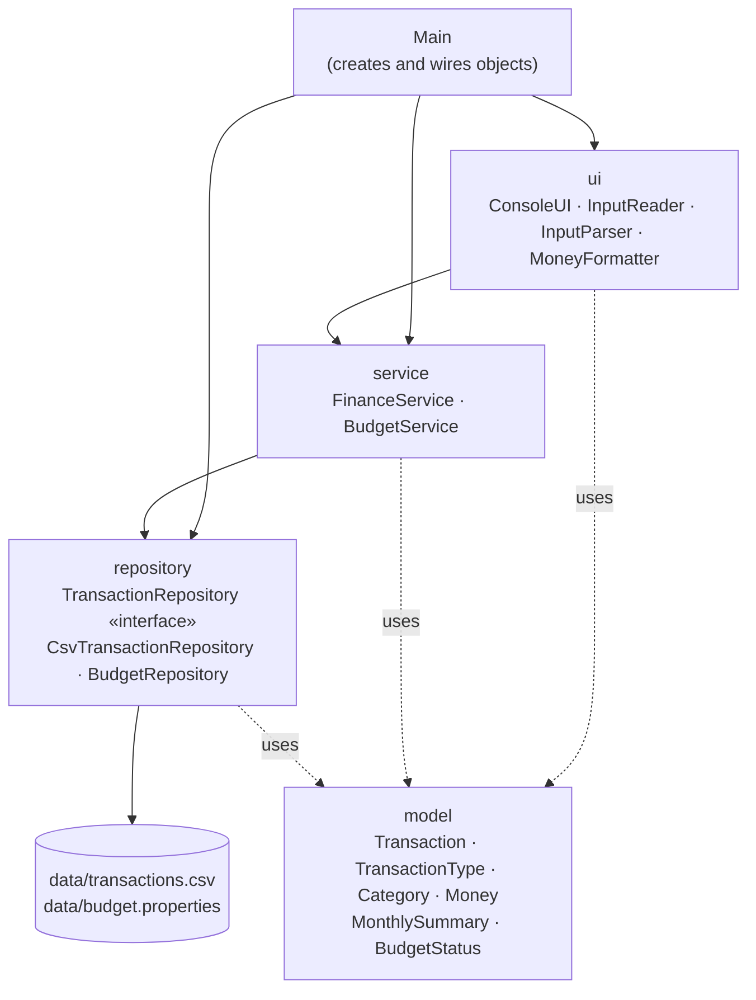

# Architecture

The application uses a simple layered architecture. Each layer has one job and only
depends on the layers below it.

## Responsibilities

| Class | Responsibility |
|---|---|
| `Main` | Reads command-line options, creates all objects and connects them, starts the UI. Handles startup errors. |
| `Transaction` | Immutable record of one income or expense. Validates all fields in its constructor. |
| `TransactionType` | Enum: `INCOME` or `EXPENSE`. |
| `Category` | Validated, case-insensitive category name. Provides the default categories per type. |
| `Money` | Shared rule for amounts: positive, at most two decimals, stored with scale 2. |
| `MonthlySummary`, `BudgetStatus` | Read-only result objects returned by the services. |
| `TransactionRepository` | Interface for storing and loading transactions. |
| `CsvTransactionRepository` | Implementation that keeps transactions in memory and saves to CSV after every change. |
| `TransactionCsv`, `CsvLine` | Convert transactions to and from CSV lines (quoting, validation, line numbers in errors). |
| `AtomicFileWriter` | Writes to a temporary file and moves it over the target, so files are never half-written. |
| `BudgetRepository` | Stores the monthly budget in a `.properties` file. |
| `FinanceService` | Business logic: adding/deleting, filtering, searching, totals, monthly summary, export. |
| `BudgetService` | Sets, removes and evaluates the monthly budget. |
| `ConsoleUI` | Menus and output. Delegates all logic to the services. |
| `InputReader` | Reads whole lines from the keyboard, repeats prompts on invalid input, supports `cancel`. |
| `InputParser` | Pure functions that turn text into amounts, dates, IDs, etc. |
| `MoneyFormatter` | Formats amounts with currency symbol and two decimals for display. |

## Design decisions

**`BigDecimal` instead of `double`.** `double` cannot represent values such as 0.10
exactly, so sums drift (`0.1 + 0.2 = 0.30000000000000004`). `BigDecimal` is exact.
All amounts are normalized to scale 2 so that `equals` and string output are consistent.

**An interface only where it has a real use.** `TransactionRepository` has two
implementations: the CSV one and an in-memory one used in the service tests. The budget
storage has only one implementation, so it is a plain class.

**Validation in the model.** `Transaction` checks its own fields. Whether a transaction
comes from the keyboard or from a manually edited CSV file, an invalid one can never
exist in memory.

**Two exception types.** `ValidationException` means "the input breaks a rule" and is
shown to the user, who can try again. `DataAccessException` means "reading or writing a
file failed" and wraps the original `IOException`. Both are unchecked, so the service
methods stay readable, and both are caught in the UI layer.

**Safe saving.** If saving fails, the repository undoes the in-memory change, so what the
user sees always matches what is on disk. If the data file is corrupted at startup, the
program exits without writing, so the damaged file can still be repaired by hand.

**Testable UI.** `ConsoleUI` receives its input stream, output stream and a `Clock`
through the constructor. Tests can therefore simulate a full session with scripted
input and a fixed date.
